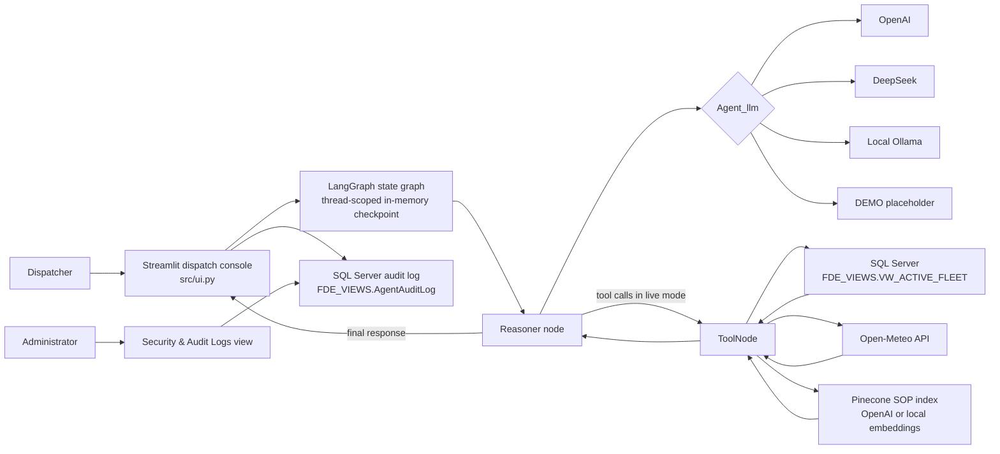
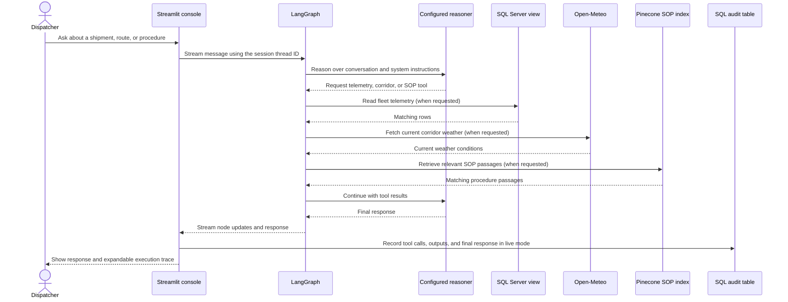
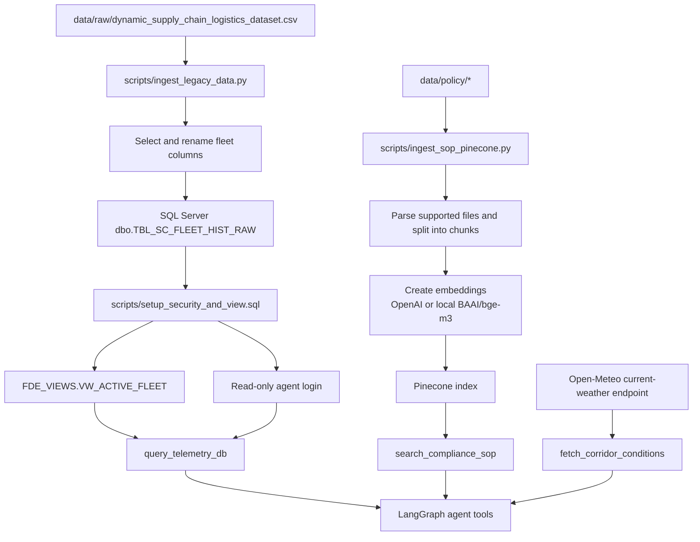
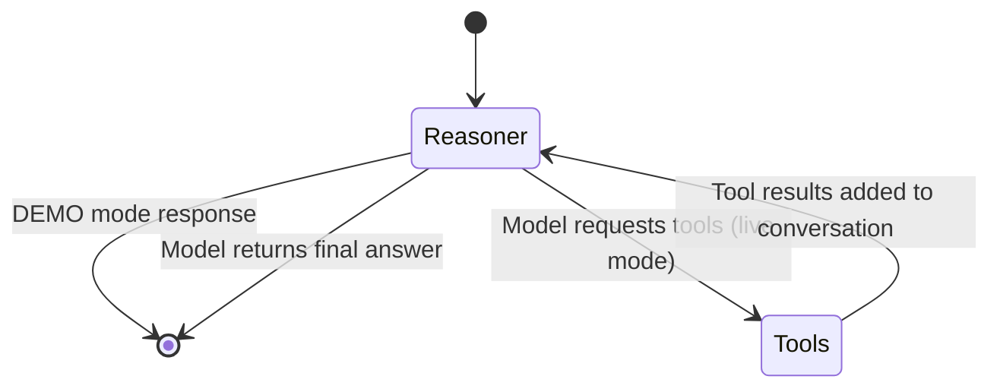
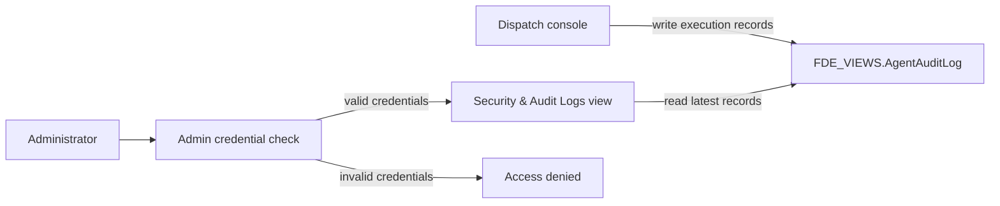

# Cold-Chain Logistics Dispatch Console

A Streamlit dispatch console for asking questions about fleet telemetry, corridor conditions, and cold-chain procedures. In live mode, a LangGraph agent can query a SQL Server view, check current weather from Open-Meteo, and retrieve relevant procedures from Pinecone. The console also includes an administrator-only audit-log view.

The repository includes a local fleet dataset and a sample cold-chain SOP. Live answers require the external services and credentials described below. In `DEMO` mode, the interface runs without those services and returns an explicit placeholder rather than a shipment assessment.

## Architecture



In live mode, the reasoner can request one or more tools. LangGraph executes the requests and returns their results to the reasoner; this cycle repeats until the model produces a final answer. The chat interface shows tool inputs and outputs in expandable trace panels. The current Streamlit app presents chat and an audit table; it does not currently render fleet charts or maps.

## Operational workflows

### Dispatch question



The system prompt directs the agent to check telemetry, corridor conditions, and SOP guidance, and to format operational answers with an executive summary, telemetry/environment analysis, an action plan, and an SOP citation. Actual tool selection is performed by the configured model.

### Data and procedure ingestion



The fleet ingestion script reads the CSV and replaces `dbo.TBL_SC_FLEET_HIST_RAW` on each run. Use it only when replacing that table is intended. The SOP ingestion script scans `data/policy/`, supports Markdown, text, PDF, CSV, and Excel files, and stores file hashes in `data/cache/ingestion_hash_cache.json` to skip unchanged files and remove deleted files from the index.

### LangGraph execution



### Audit-log access



The audit table is separate from the fleet view. The SQL setup script does not create it; create the table and grant the required permissions before relying on audit logging. Audit write failures are reported to the application log.

## Repository layout

```text
.
├── data/
│   ├── cache/       # SOP ingestion hash cache
│   ├── policy/      # SOP and other policy source documents
│   ├── raw/         # Fleet telemetry CSV
│   └── source/      # Dataset source reference
├── docs/            # Project setup notes
├── scripts/
│   ├── ingest_legacy_data.py
│   ├── ingest_sop_pinecone.py
│   └── setup_security_and_view.sql
├── src/
│   ├── prompts/system_prompt.txt
│   ├── agent_tools.py
│   ├── orchestrator.py
│   └── ui.py
└── requirements.txt
```

## Requirements

- Python 3.12 (the version recorded in `requirements.txt`)
- SQL Server and Microsoft ODBC Driver 18 for SQL Server for live telemetry and audit workflows
- A Pinecone API key for live SOP retrieval
- A supported reasoner: OpenAI, DeepSeek, or a local Ollama service with `qwen2.5:7b`
- Internet access for Open-Meteo corridor weather requests

`DEMO` mode does not require the reasoner, database, or Pinecone credentials to open the UI. It does not provide live data or operational assessments.

## Setup

### 1. Create an environment

From the repository root, create and activate a virtual environment, then install dependencies:

```powershell
py -3.12 -m venv .venv
.\.venv\Scripts\Activate.ps1
python -m pip install -r requirements.txt
```

If PowerShell prevents activation, use the environment's interpreter directly: `.venv\Scripts\python.exe`.

### 2. Configure environment variables

Copy `.env.example` to `.env` and fill in the values required for your selected services. Do not commit `.env` or put credentials in source control.

| Variable | Purpose |
| --- | --- |
| `Agent_llm` | `DEMO`, `OPENAI`, `DEEPSEEK`, or `OLLAMA`; defaults to `OLLAMA` in the orchestrator |
| `OPENAI_API_KEY` | OpenAI reasoner credentials when using `OPENAI`; also used for OpenAI embeddings |
| `DEEPSEEK_API_KEY` | DeepSeek reasoner credentials when using `DEEPSEEK` |
| `Embeddings_model` | `LOCAL` (default) or `OPENAI`; selects the Pinecone embedding/index pair |
| `Local_Embedding_Model` | Local embedding model; defaults to `BAAI/bge-m3` |
| `PINECONE_API_KEY` | Pinecone access for SOP ingestion and retrieval in live mode |
| `SQL_SERVER_HOST`, `SQL_SERVER_PORT` | SQL Server address; defaults are `localhost` and `1433` |
| `SQL_AGENT_USER`, `SQL_AGENT_PASSWORD` | SQL login intended for agent data access |
| `SQL_ADMIN_USER`, `SQL_ADMIN_PASSWORD` | Administrative login for setup and audit-log inspection |

`OPENAI` embeddings use the `fde-sop-index-openai` index; local embeddings use `fde-sop-index-local`. The index must match the embedding model used to create it.

### 3. Prepare the SQL Server fleet view

1. Provision a SQL Server instance and ensure the Microsoft ODBC Driver 18 is installed.
2. Set the SQL connection variables in `.env`.
3. Review `scripts/setup_security_and_view.sql` and replace its example login password with a strong secret before running it as a SQL administrator. The script creates `FDE_VIEWS.VW_ACTIVE_FLEET` over `dbo.TBL_SC_FLEET_HIST_RAW` and grants the agent login access to that view.
4. If loading the included dataset, check the script's database target and run:

   ```powershell
   python scripts/ingest_legacy_data.py
   ```

   The script replaces the raw table each time it runs. `SQL_ADMIN_USER` and `SQL_ADMIN_PASSWORD` must be set for ingestion.
5. Run the security/view SQL after the raw table exists.

The SQL setup script does not create `FDE_VIEWS.AgentAuditLog`. For the audit screen and execution logging, create that table separately as an administrator and grant the application login the required `INSERT` permission. Grant the administrator account read access to the table for audit viewing.

**Live SQL configuration note:** The connection-string builders in `src/agent_tools.py`, `src/ui.py`, and `scripts/ingest_legacy_data.py` currently contain a literal masked password in place of the configured SQL password. Set up secure environment-based password handling in those connection strings before expecting live database access to work; do not put real credentials in source files.

### 4. Index the SOP documents

Set `PINECONE_API_KEY` and select the embedding model in `.env`, then run:

```powershell
python scripts/ingest_sop_pinecone.py
```

The script creates or checks the matching Pinecone index and indexes files found directly in `data/policy/`. Local embedding models are downloaded and run on CPU.

### 5. Start the application

```powershell
streamlit run src/ui.py
```

Open the local URL printed by Streamlit. Select **Dispatch Console** to chat with the agent or **Security & Audit Logs** to authenticate and inspect audit records. In live mode, a new session receives its own thread ID; its LangGraph checkpoint is kept in process memory.

The LangGraph command-line harness can also be run with:

```powershell
python src/orchestrator.py
```

The agent tools module can be run directly for local tool checks, but it requires the live Pinecone configuration:

```powershell
python src/agent_tools.py
```

## Deployment

The manual GitHub Actions workflow is `.github/workflows/deploy.yml`. It connects to an EC2 host over SSH, pulls the `main` branch, activates the server-side virtual environment, and restarts the `streamlit` systemd service. Configure the `EC2_HOST`, `EC2_USER`, and `EC2_SSH_KEY` repository/environment secrets, create the target GitHub environment, and provision the service and its environment on the host before dispatching the workflow.

See [docs/instrutions.md](docs/instrutions.md) for the project's existing environment and deployment notes. Review those notes before use; they include environment-specific setup details.
